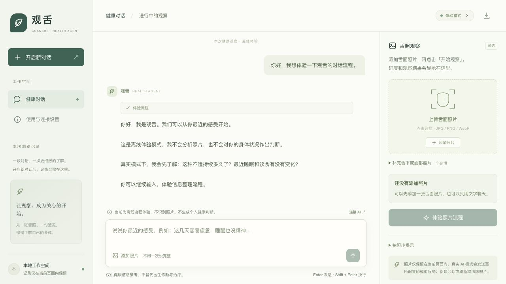
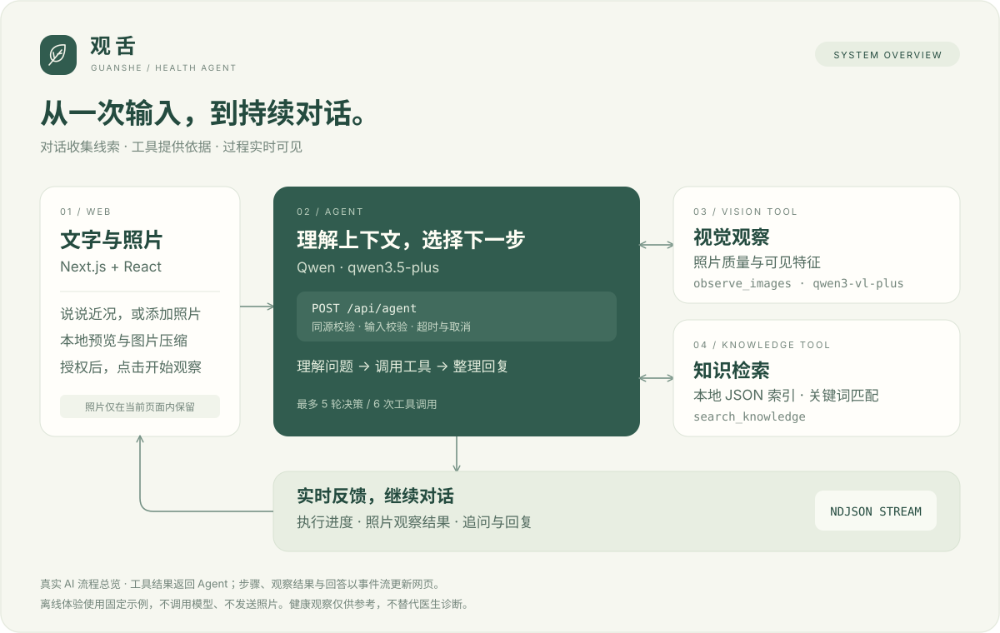
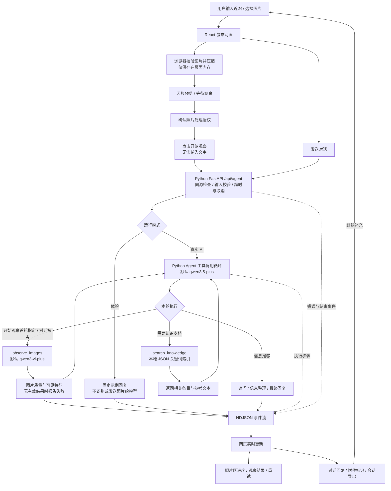

# 观舌 · Python 网页健康观察 Agent

通过连续对话，把用户近况、舌照观察与本地知识检索串联起来，形成可继续追问的健康信息整理流程。

**Python 3.11+ · FastAPI · Qwen 多模态 · 工具调用 · NDJSON · MIT**



## 演示视频

[观看 28 秒演示视频](https://github.com/jeremy-nbd/guanshe-agent/blob/main/docs/assets/demo.mp4)

视频由 Python 服务实际运行时的关键画面剪辑而成，依次展示选择离线体验、输入问题、查看执行步骤、继续对话和生成报告结构。视频中的内容为固定流程示例。

## 核心亮点

| 要解决的问题 | 项目实现 |
| --- | --- |
| 用户信息分散在多次输入中 | 保留会话上下文，以追问补齐信息，支持总结与导出 |
| 普通聊天难以调用图片与知识能力 | Python Agent 按需选择视觉观察和知识检索工具，工具结果回传模型 |
| 上传照片后不知道是否开始处理 | 独立照片状态与观察事件，展示等待、分析、结果和失败重试 |
| 模型长时间无响应或调用失控 | 单次及整体超时、用户取消、最多 5 轮决策与 6 次工具调用 |
| 下载项目后启动步骤复杂 | Python 单服务托管 API 和预编译网页，安装依赖后运行 `python run.py` |

核心服务采用 Python + FastAPI。React / TypeScript 用于维护网页交互，构建结果随仓库发布。知识检索基于本地 JSON 关键词索引，当前包含 4,163 条条目。

## 技术流程图



<details>
<summary>展开完整技术流程</summary>



</details>

**两种触发方式：**“开始观察”指定首轮调用 `observe_images`，随后将视觉结果交给文本模型继续整理；普通聊天由 Agent 按需选择工具。照片工具通过独立 `observation` 事件报告开始、完成或失败，因此右侧可以在最终聊天回复生成前展示观察结果。

照片仅在点击发送或开始观察后提交；选图本身不会调用模型。照片更新或移除后，旧的观察结果立即清除，防止与新照片混淆。体验模式下照片不会发送到服务端。服务端最多执行 5 轮决策和 6 次工具调用，支持用户取消及整体超时。

## 启动 Agent

```bash
python3.12 -m venv .venv
source .venv/bin/activate
pip install -r requirements.txt
python run.py
```

需要 Python 3.11 或更新版本，推荐 3.12。Windows 使用 `py -3.12 -m venv .venv` 创建环境，通过 `.venv\Scripts\activate` 激活。

打开 http://127.0.0.1:3210 。默认只绑定本机。未配置密钥时为明确标注的**离线体验模式**：固定示例不识别照片、不解读健康输入、不伪造分析。

连接真实 AI：复制 `.env.example` 为 `.env.local`，填写 `LLM_API_KEY`。支持 `LLM_BASE_URL`、`LLM_DEFAULT_MODEL_ID`、`LLM_TEMPERATURE`、`LLM_TIMEOUT_S`、`VLM_DEFAULT_MODEL_ID` 和 `VLM_TIMEOUT_S`；这些配置优先于旧的 DMX / QWEN 配置，旧密钥变量仍兼容。按服务实际支持情况设置文本模型和视觉模型，然后重启服务。文本模型必须支持 Chat Completions 的 tool calling，视觉模型必须支持图片输入。密钥不得放入 `NEXT_PUBLIC_*` 变量或聊天框。

## 使用方式

1. 说说最近的感受，或点击首页话题填入输入框。
2. 可选择上传舌面、舌下或面部照片，三种照片都不是必填项。支持 JPEG、PNG、WebP，原图不超过 8MB，浏览器压缩至最长边 1200px。
3. 照片区会提示“照片已添加 · 等待观察”；真实模式勾选处理授权后，直接点击“开始观察”，无需先输入文字。舌下与面部照片可在“补充舌下或面部照片”中添加。
4. 照片区展示提交、观察、结果或失败反馈。失败或停止后保留照片，可重新观察；观察结果也会参与聊天回复。照片不可用时，模型应返回具体重拍原因。
5. 可继续追问、要求总结、停止当前处理，或使用右上角按钮导出文本会话。
6. 新建会话会清除当前照片与观察结果；最近 8 次会话暂存在页面内存（只保留附件名称，不保留照片），刷新后全部清除。切换模式也会新建会话。

手机排版中，点击输入框旁的“添加照片”即可跳到照片区，在那里完成选图、开始观察和查看结果。

## Agent 实现

- `src/features/agent/AgentPage.tsx`：独立对话首页、图片处理、会话上下文、过程展示、取消和错误恢复。
- `guanshe/server.py`：GET 返回连接状态；POST 校验输入并返回 NDJSON 事件流，包含 `step`、`observation`、`answer`、`error`、`done`。`action=observe` 触发明确的照片观察；省略 `action` 默认为 `chat`。
- `guanshe/agent.py`：模型自主选择工具，服务端执行并将结果回传模型，再生成回复。最多 5 次决策、6 次工具调用，整体超时按 5 次文本调用预算 + 1 次视觉调用预算计算，最多 900 秒；文本默认每次 60 秒，视觉默认每次 120 秒。
- `observe_images`：调用视觉模型判断上传内容、质量和可见特征，不执行诊断；未上传部位不能推断。
- `search_knowledge`：复用项目本地中医知识索引。返回参考材料和条目标题；资料未经过本项目临床验证，不能当作诊断依据。
- `guanshe/validation.py`：限制角色、对话长度、图片数与大小，核对图片 MIME 和文件签名。

工具循环参考 [阿里云 Function Calling 文档](https://www.alibabacloud.com/help/en/model-studio/qwen-function-calling)。模型和供应商差异可能影响 tool calling；需要用自己的服务配置做真实联调。

## 开发与目录

- `run.py` 是 Python 启动入口，支持 `--host` 和 `--port`。
- `guanshe/` 包含 FastAPI 接口、Agent 循环、配置、提示词、输入校验及知识检索。
- `data/tcmRagIndex.json` 是本地知识索引。
- `web/` 是随仓库发布的网页构建产物，由 FastAPI 托管。
- `src/` 保留 React / TypeScript 界面源码，用于修改浏览器交互。

修改界面后使用 Node.js 20.9+ 执行以下命令，再启动 Python 服务预览。构建命令自动更新 `web/`，界面改动与构建产物应一起提交。

```bash
npm ci
npm run build
python run.py
```

服务通过 [FastAPI 静态资源托管](https://fastapi.tiangolo.com/tutorial/static-files/) 提供网页，通过 [HTTPX 异步客户端](https://www.python-httpx.org/async/) 请求模型。

## 数据与能力边界

Agent 接口不将照片、对话或工具内容写入磁盘，不接入外部监控。真实模式会向配置的模型供应商发送对话，视觉工具执行时发送照片；供应商的数据保留政策由其服务约定决定。前端的步骤列表是工具执行状态，不是模型内部推理。

这是本地试用版：没有账号、服务端历史记录、多用户隔离或公开服务配额控制，请勿直接暴露到公网。Agent 的提示词约束其不确诊、不处方、不推荐药物剂量；这些约束不是医学可靠性保证，产品尚未经临床验证。

验证命令：

```bash
python -m unittest discover -s tests -v
# 可选：使用 Node.js 运行原有端到端协议回归
npm run test:agent
```

自动化集成测试使用本机模拟模型服务验证真实工具调用协议、上下文、输入校验和错误恢复，不调用付费模型，不验证医学准确性。真实图片识别和回答质量需配置密钥后单独验证。

## 开源许可

原创代码与文档采用 [MIT License](LICENSE)，版权署名为 `jeremy-nbd`。第三方软件保留原许可证。知识索引的原始数据许可仍需核实，具体来源记录与授权范围见 [第三方说明](THIRD_PARTY_NOTICES.md)。

根目录提供独立许可证文件，便于下载者了解使用、修改和分发条件。参见 [GitHub 许可证说明](https://docs.github.com/en/repositories/managing-your-repositorys-settings-and-features/customizing-your-repository/licensing-a-repository)。
